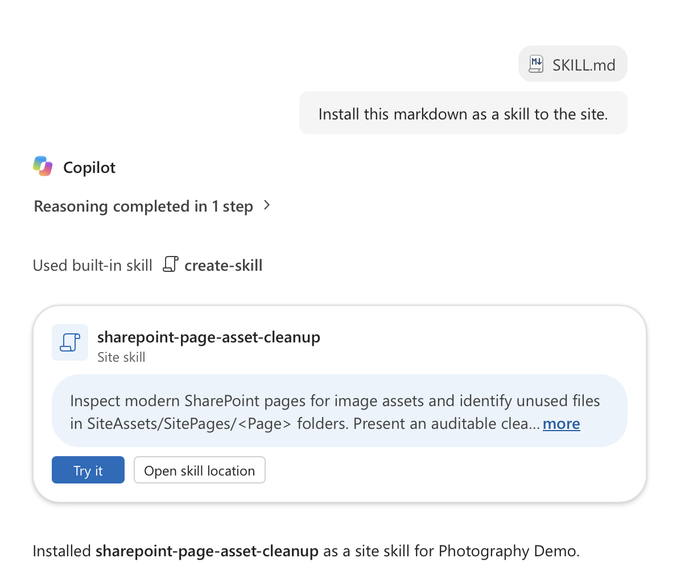
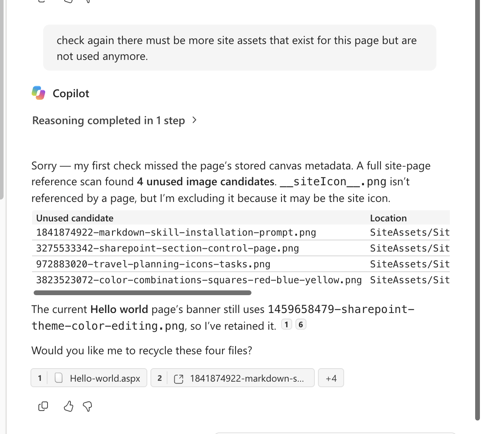
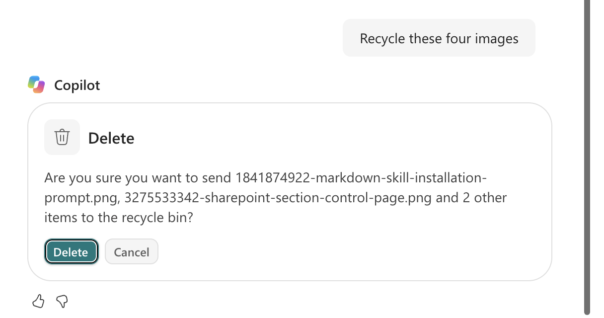

# SharePoint page assets cleanup

A skill that audits the image assets of a modern SharePoint page and safely cleans up unused files in its asset folder (`SiteAssets/SitePages/<Page>`).

Every image you upload while editing a page lands in that folder, and nothing ever removes it, even after you replace or delete the image on the page. Over time these folders fill up with duplicates, timestamped re-uploads, and orphaned files. This skill finds them and helps you get rid of them without breaking anything.

Skill source: [skills/sharepoint-page-assets-cleanup/SKILL.md](../../../skills/sharepoint-page-assets-cleanup/SKILL.md)

## What it does

1. **Inventory**: reads the page through the SharePoint REST API and lists every image it uses, grouped into site-hosted assets, Microsoft stock images, and the banner image. It also flags common issues such as a default `sitepagethumbnail.png` banner or duplicate uploads.
2. **Find unused files**: lists the page's asset folder and checks each file against the content of **every page on the site**, not only the target page.
3. **Propose a cleanup**: reports totals and unused MB, and shows a table of candidates with the reason each one is a candidate. Nothing is changed at this point.
4. **Recycle after confirmation**: asks before touching anything, then moves confirmed files to the recycle bin.
5. **Verify**: lists the folder again and confirms that every referenced file still exists.

## Install as a SharePoint site skill

1. Open the SharePoint site and start Copilot.
2. Attach [`SKILL.md`](../../../skills/sharepoint-page-assets-cleanup/SKILL.md) and ask: *"Install this markdown as a skill to the site."*
3. Copilot uses its built-in `create-skill` skill and confirms the installation. Use **Try it** to run the skill right away, or **Open skill location** to see where it's stored.



## Usage

On the site, ask Copilot something like:

- "List the images this SharePoint page uses."
- "Clean up unused page assets for the Hello world page."
- "Check this page for images that aren't needed."
- "Find unused files in the SitePages asset folder."

Copilot answers with a list of candidates and keeps files that are still in use, such as the current banner image. It also leaves out files that may have another purpose, such as `__siteIcon__.png`.



> **Tip:** If the result looks incomplete, ask Copilot to check again. In the run above, the first pass missed the page's stored canvas metadata. A follow-up prompt made it run the full site-page reference scan.

When you confirm, SharePoint shows its own confirmation dialog before anything goes to the recycle bin.



Inputs the skill works with:

| Input | Required | Notes |
|---|---|---|
| Page | Yes | The modern page to inspect, by name or server-relative path |
| Site URL | No | The current site when you run it from Copilot in SharePoint |
| Asset folder | No | Derived from the page name if omitted |
| Mode | No | Inventory only, or cleanup after confirmation |

## Use with Claude Code

The skill also works with agents that can load skills and drive a browser, for example Claude Code with [Claude in Chrome](https://claude.ai/chrome). It runs the REST calls in a browser tab that is signed in to the site, so no app registration or tokens are needed.

```bash
cp -r skills/sharepoint-page-assets-cleanup ~/.claude/skills/
```

## Safety

- **No changes during an inventory scan.** Files are only touched after you explicitly confirm.
- **Recycle, never delete.** Files go to the recycle bin and can be restored for 93 days. The skill never empties the recycle bin.
- **Conservative matching.** A file counts as used if its name (or URL-encoded name) appears anywhere in any page on the site. Originals behind Image web part shape crops and cached stock images are kept.
- **Icon-style files** (such as `org-chart@2x.png`) are offered for retention because they may be reused as Quick Links icons.
- **No sensitive output.** Raw page content, query strings, and tokens are not printed.

## Limitations

The scan only sees references within the current site's Site Pages library. It **cannot** detect references from:

- other sites, news rollups, or hub navigation
- custom CSS or SPFx extensions
- older page versions that might be restored later

Review the proposal with that in mind before you confirm a cleanup. You can also ask Copilot to check whether older page versions reference the candidates.
